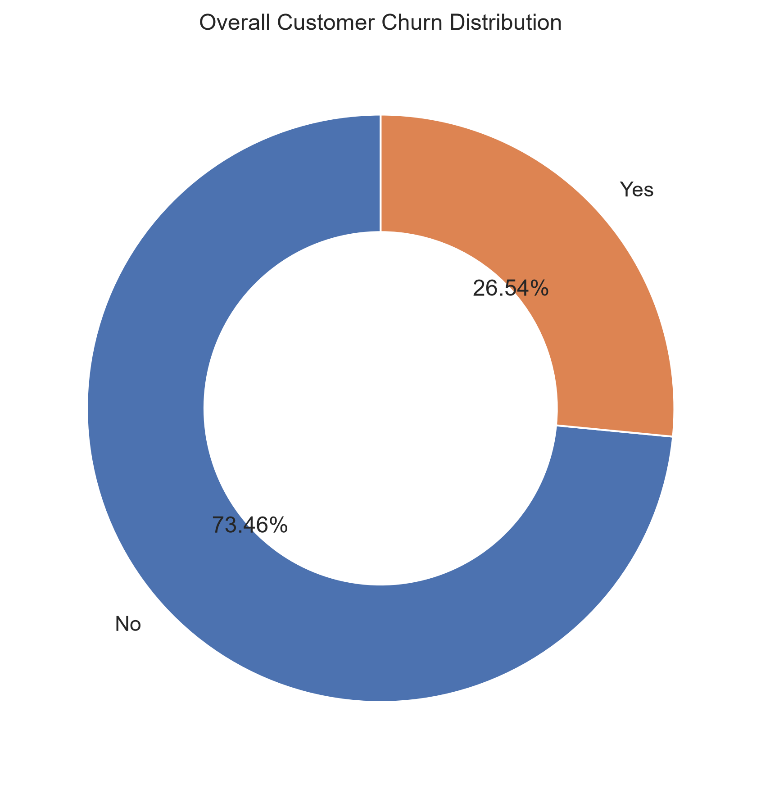
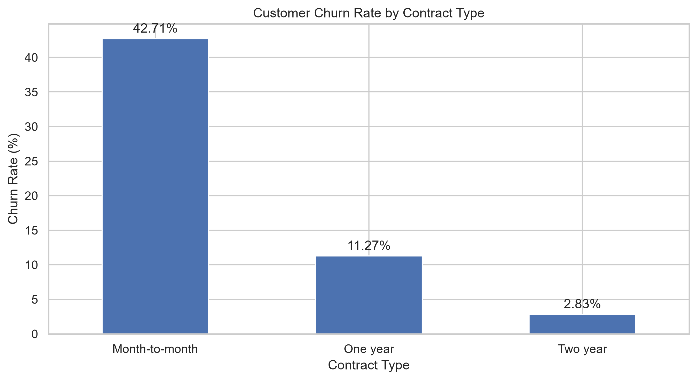
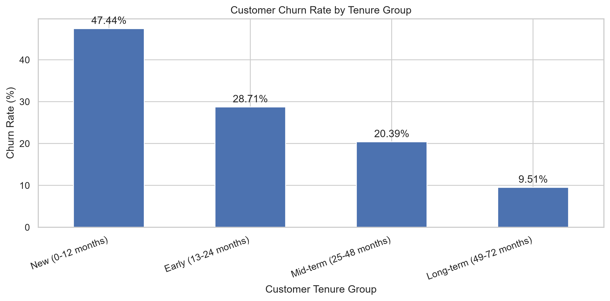
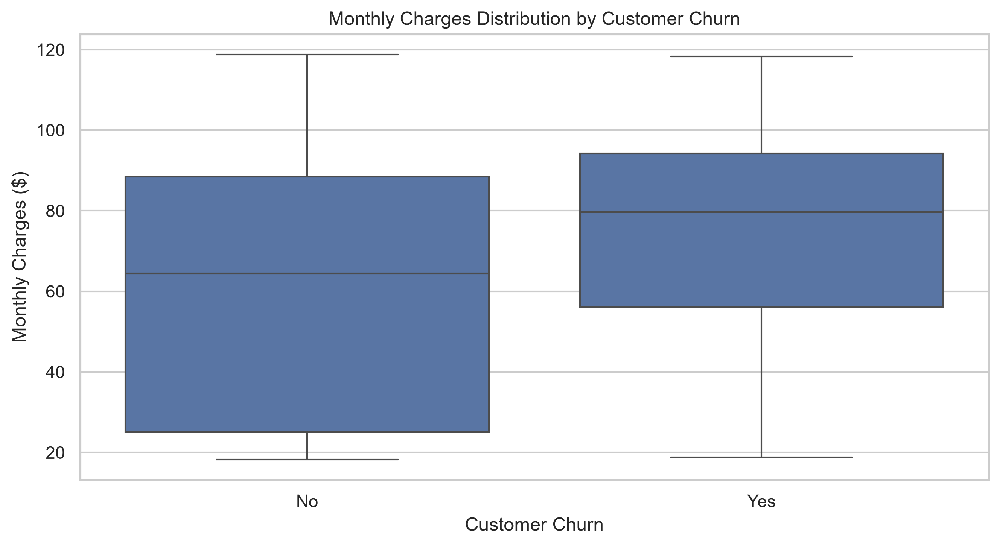
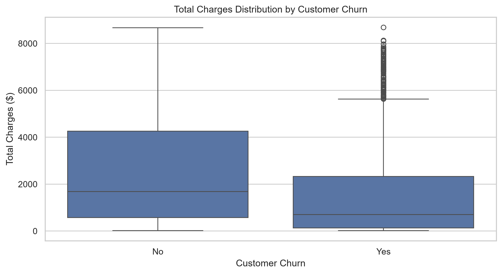

<h1 align="center">📉 Telecom Customer Churn Analysis</h1>

<p align="center">
  <b>End-to-end data analytics project using SQL Server, Python and statistical testing</b>
</p>

<p align="center">
  
  
  
  
  
</p>

---

## 📑 Table of Contents

- [Overview](#-overview)
- [Quick Results](#-quick-results)
- [Business Objectives](#-business-objectives)
- [Dataset](#-dataset)
- [Tools and Technologies](#-tools-and-technologies)
- [Project Workflow](#-project-workflow)
- [Key Insights](#-key-insights)
- [Revenue Analysis](#-revenue-analysis)
- [Python EDA](#-python-eda)
- [Statistical Hypothesis Testing](#-statistical-hypothesis-testing)
- [Retention Strategies](#-retention-strategies)
- [Limitations](#-limitations)
- [Project Structure](#-project-structure)
- [How to Run](#-how-to-run)
- [Executive Summary Report](#-executive-summary-report)
- [Conclusion](#-conclusion)

---

## 🔍 Overview

Customer churn is a major business problem for telecom companies. Every customer who leaves reduces revenue and slows long-term growth.

This project studies telecom customer data to find churn patterns, understand customer behavior, estimate revenue exposure and suggest data-driven retention strategies.

The work follows a full analytics workflow: SQL Server analysis, Python exploratory data analysis (EDA) and statistical hypothesis testing.

## ⚡ Quick Results

| Metric | Result |
|---|---:|
| Overall churn rate | **26.54%** |
| Churn rate, month-to-month contracts | **42.71%** |
| Churn rate, new customers (0–12 months) | **47.44%** |
| Churn rate, electronic check users | **45.29%** |
| Churn rate, fiber optic users | **41.89%** |
| Monthly charges tied to churned customers | **$139,130.85** |

## 🎯 Business Objectives

- Analyze overall churn and retention rates.
- Find customer segments with high churn.
- Understand how customer characteristics relate to churn.
- Measure revenue exposure from churned customers.
- Use statistical tests to validate the patterns found.
- Develop practical retention recommendations.

## 📦 Dataset

| Attribute | Details |
|---|---|
| Dataset | Telco Customer Churn |
| Source | IBM Telco Customer Churn Dataset (Kaggle) |
| Total records | 7,043 |
| Total columns | 21 |
| Target variable | `Churn` |
| Customer identifier | `customerID` |

The data includes customer demographics, account information, subscribed services, contract details, payment methods and churn status.

## 🛠️ Tools and Technologies

| Category | Tools |
|---|---|
| Programming | Python |
| Data analysis | Pandas, NumPy |
| Visualization | Matplotlib, Seaborn |
| Database | Microsoft SQL Server |
| Statistics | SciPy, Statsmodels |
| Development | Jupyter Notebook, VS Code |
| Version control | Git, GitHub |

## 🔄 Project Workflow

1. Data profiling
2. Data cleaning
3. SQL-based churn analysis
4. SQL-based revenue analysis
5. Python exploratory data analysis
6. Statistical hypothesis testing
7. Retention strategy development
8. Executive summary report
9. GitHub documentation

## 💡 Key Insights

### 1. Overall Churn

| Metric | Result |
|---|---:|
| Total customers | 7,043 |
| Churned customers | 1,869 |
| Retained customers | 5,174 |
| Churn rate | 26.54% |
| Retention rate | 73.46% |

### 2. Churn by Contract Type

| Contract Type | Customers | Churned | Churn Rate |
|---|---:|---:|---:|
| Month-to-month | 3,875 | 1,655 | 42.71% |
| One year | 1,473 | 166 | 11.27% |
| Two year | 1,695 | 48 | 2.83% |

> **Finding:** Month-to-month customers churn the most. They make up 88.55% of all churned customers.

### 3. Churn by Tenure

| Tenure Group | Customers | Churned | Churn Rate |
|---|---:|---:|---:|
| New (0–12 months) | 2,186 | 1,037 | 47.44% |
| Early (13–24 months) | 1,024 | 294 | 28.71% |
| Mid-term (25–48 months) | 1,594 | 325 | 20.39% |
| Long-term (49–72 months) | 2,239 | 213 | 9.51% |

> **Finding:** New customers are the biggest risk. New month-to-month customers churn at 51.35% and make up 54.79% of all churned customers.

### 4. Churn by Payment Method

| Payment Method | Churn Rate |
|---|---:|
| Electronic check | 45.29% |
| Mailed check | 19.11% |
| Bank transfer (automatic) | 16.71% |
| Credit card (automatic) | 15.24% |

> **Finding:** Electronic check users churn far more than customers on automatic payments.

### 5. Churn by Internet Service

| Internet Service | Churn Rate |
|---|---:|
| Fiber optic | 41.89% |
| DSL | 18.96% |
| No internet service | 7.40% |

> **Finding:** Fiber optic customers have the highest churn among internet service groups.

## 💰 Revenue Analysis

Revenue exposure is based on the monthly charges of customers who churned.

| Metric | Result |
|---|---:|
| Churned customers | 1,869 |
| Monthly charges tied to churned customers | $139,130.85 |
| Average monthly charges per churned customer | $74.44 |
| Illustrative annualized amount | $1,669,570.20 |

### Revenue Exposure by Segment

| Segment | Share of Churned Monthly Charges |
|---|---:|
| Month-to-month contracts | 86.86% |
| Fiber optic customers | 82.16% |
| Electronic check customers | 60.59% |
| New customers | 49.56% |

> **Note:** The annualized figure is monthly charges multiplied by 12. It is an illustrative run-rate estimate, not a verified future or realized loss. The segments overlap, so the percentages should not be added together.

## 📊 Python EDA

EDA was done with Pandas, NumPy, Matplotlib and Seaborn. It covers:

- Overall churn distribution
- Churn by contract type, tenure group, payment method and internet service
- Churn by additional services, paperless billing and senior citizen status
- Revenue exposure across customer segments
- Distributions of monthly charges, tenure and total charges

In total, 15 visualizations are saved in the `visuals/` folder. Selected charts:

<table>
  <tr>
    <td align="center"><b>Overall Churn</b><br></td>
    <td align="center"><b>Churn by Contract</b><br></td>
  </tr>
  <tr>
    <td align="center"><b>Churn by Tenure</b><br></td>
    <td align="center"><b>Monthly Charges</b><br></td>
  </tr>
  <tr>
    <td align="center" colspan="2"><b>Total Charges</b><br></td>
  </tr>
</table>

## 🧪 Statistical Hypothesis Testing

Tests used:

- Chi-square test of independence
- Mann–Whitney U test
- Cramér's V (strength of association)
- Holm-Bonferroni correction for multiple testing

<details>
<summary><b>Click to see all test results</b></summary>

| Variable | Test | P-value |
|---|---|---:|
| Contract | Chi-square | 5.86 × 10⁻²⁵⁸ |
| Tenure Group | Chi-square | 2.94 × 10⁻¹⁸⁵ |
| Payment Method | Chi-square | 3.68 × 10⁻¹⁴⁰ |
| Internet Service | Chi-square | 9.57 × 10⁻¹⁶⁰ |
| Online Security | Chi-square | 2.66 × 10⁻¹⁸⁵ |
| Tech Support | Chi-square | 1.44 × 10⁻¹⁸⁰ |
| Paperless Billing | Chi-square | 4.07 × 10⁻⁵⁸ |
| Senior Citizen | Chi-square | 1.51 × 10⁻³⁶ |
| Tenure | Mann–Whitney U | 2.42 × 10⁻²⁰⁸ |
| Monthly Charges | Mann–Whitney U | 3.31 × 10⁻⁵⁴ |
| Total Charges | Mann–Whitney U | 2.00 × 10⁻⁸⁴ |

</details>

**Key findings**

- All 11 tests stayed significant after Holm correction at the 0.05 level.
- Contract type has the strongest association among the categorical variables (Cramér's V ≈ 0.410).
- Tenure also has a strong relationship with churn.
- Churned customers have a lower median tenure (10 months) than retained customers (38 months).
- Churned customers have higher median monthly charges ($79.65) than retained customers ($64.43).

> Statistical significance does not prove causation. These results show associations within this dataset.

## 🛡️ Retention Strategies

Three priority segments were selected based on the analysis.

### 1. New Customer Retention

**Problem:** New customers churn at 47.44%.

**Recommendations**
- Improve the onboarding experience.
- Check in proactively during the first 90 days.
- Catch billing and service complaints early.
- Offer suitable incentives for longer-term contracts.

**KPIs:** 90-day retention rate, new customer churn rate, complaint resolution time, conversion to longer-term contracts.

### 2. Fiber Optic Customer Retention

**Problem:** Fiber optic customers churn at 41.89%.

**Recommendations**
- Investigate service-quality concerns.
- Monitor technical complaints.
- Improve support response times.
- Review customer satisfaction and unresolved issues.

**KPIs:** Fiber optic churn rate, complaint resolution time, unresolved complaints, customer satisfaction.

### 3. Electronic Check Customer Retention

**Problem:** Electronic check customers churn at 45.29%.

**Recommendations**
- Investigate payment-related complaints.
- Improve billing communication and reminders.
- Explain the available payment alternatives.
- Monitor payment issues without forcing customers to change their payment method.

**KPIs:** Electronic check churn rate, payment failure rate, billing complaints, successful payment rate, automatic payment adoption.

> **Pilot approach:** Test each initiative with a treatment-versus-control pilot before rolling it out widely.

## ⚠️ Limitations

- Results show associations, not causes.
- The revenue figure is an illustrative run-rate, not realized loss.
- The data is a single snapshot from one public dataset, so findings may not carry over to other telecom companies.

## 🗂️ Project Structure

```text
telecom-customer-churn-analysis/
│
├── data/
│   ├── raw/
│   └── processed/
│
├── sql/
│   ├── 01_data_profiling.sql
│   ├── 02_data_cleaning.sql
│   ├── 03_churn_analysis.sql
│   └── 04_revenue_analysis.sql
│
├── notebooks/
│   ├── 01_data_understanding.ipynb
│   ├── 02_eda.ipynb
│   ├── 03_statistical_testing.ipynb
│   └── 04_retention_strategy.ipynb
│
├── reports/
│   └── Telecom_Customer_Churn_Executive_Summary.pdf
│
├── visuals/
│   └── 15 exported visualization files
│
├── README.md
└── requirements.txt
```

## 🚀 How to Run

**1. Clone the repository**

```bash
git clone https://github.com/satyam-katara/telecom-customer-churn-analysis.git
cd telecom-customer-churn-analysis
```

**2. Create a virtual environment**

```bash
python -m venv venv
```

**3. Activate it**

```powershell
# Windows (PowerShell)
.\venv\Scripts\Activate.ps1
```

```bash
# macOS / Linux
source venv/bin/activate
```

**4. Install dependencies**

```bash
pip install -r requirements.txt
```

**5. Run the notebooks**

```bash
jupyter notebook
```

Run the notebooks in order, from `01` to `04`.

**6. Run the SQL scripts**

Set up SQL Server, create the `TelecomChurnDB` database, load the cleaned customer table and run the scripts in the `sql/` folder in order.

## 📄 Executive Summary Report

The final summary is here: [`reports/Telecom_Customer_Churn_Executive_Summary.pdf`](reports/Telecom_Customer_Churn_Executive_Summary.pdf)

## ✅ Conclusion

Four groups are linked to higher churn: month-to-month customers, new customers, electronic check users and fiber optic users.

By combining SQL analysis, Python EDA and statistical testing, this project gives a clear picture of who churns and suggests ways to improve retention. A telecom business can use these findings to focus customer support, look into likely churn drivers and design measurable retention experiments.

---

<p align="center">
  <b>Project Type:</b> End-to-End Data Analytics &nbsp;|&nbsp;
  <b>Domain:</b> Telecommunications &nbsp;|&nbsp;
  <b>Focus:</b> Churn, Revenue Analysis, Statistical Testing, Retention Strategy
</p>
